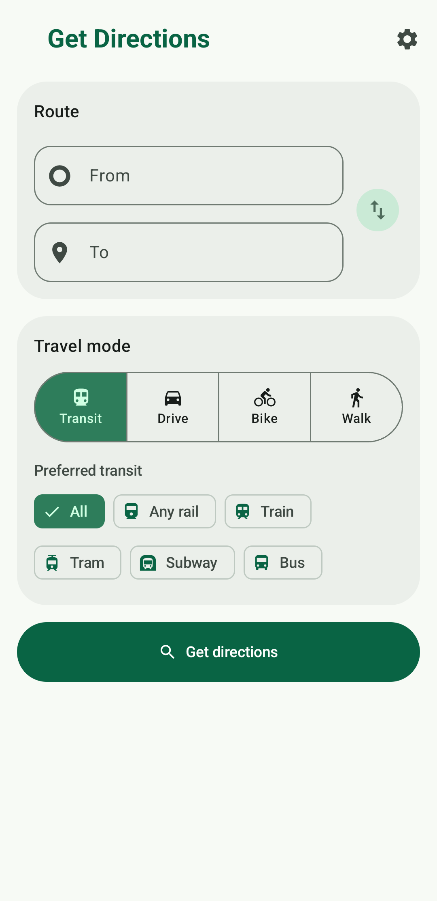
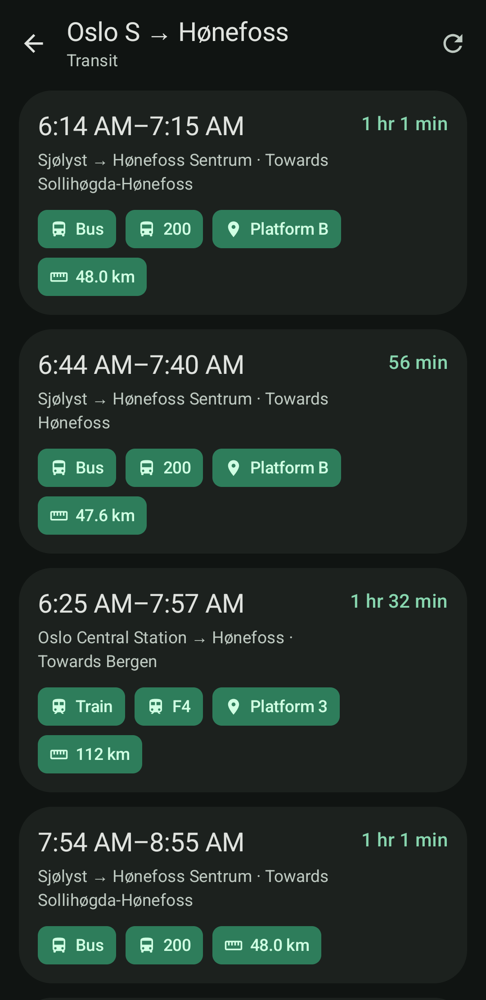
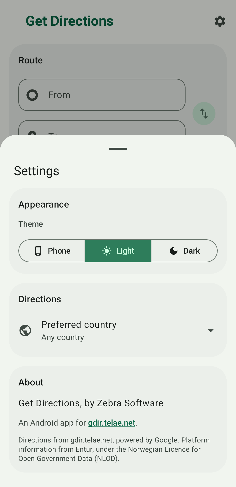

# Get Directions

A simple, text-based public transport, driving, cycling and walking directions app for Android.

Get Directions (Gdir) is an Android app for [gdir.telae.net](https://gdir.telae.net/). It shows clear, readable directions without a map.

## Features

- Directions by public transport, car, bike or on foot
- Choose preferred public transport: rail, train, tram, subway or bus
- Several route options with times, durations and step-by-step directions
- Departure platforms for public transport in Norway, from [Entur](https://entur.no/)
- Light, dark or phone theme, built with Material Design 3

## Screenshots

  
  
  

## Download

Get the latest APK from the [Releases](../../releases) page.

Get Directions needs Android 16 or newer.

## Credits

- Directions come from [gdir.telae.net](https://gdir.telae.net/), which is powered by Google.
- Platform information comes from [Entur](https://developer.entur.org/)'s open APIs, licensed under the [NLOD](https://data.norge.no/nlod/en/2.0).

## License

Copyright (C) 2026 Zebra Software

This program is free software: you can redistribute it and/or modify it under the terms of the GNU General Public License as published by the Free Software Foundation, version 3.

This program is distributed in the hope that it will be useful, but WITHOUT ANY WARRANTY; without even the implied warranty of MERCHANTABILITY or FITNESS FOR A PARTICULAR PURPOSE. See the [LICENSE](LICENSE) file for details.
